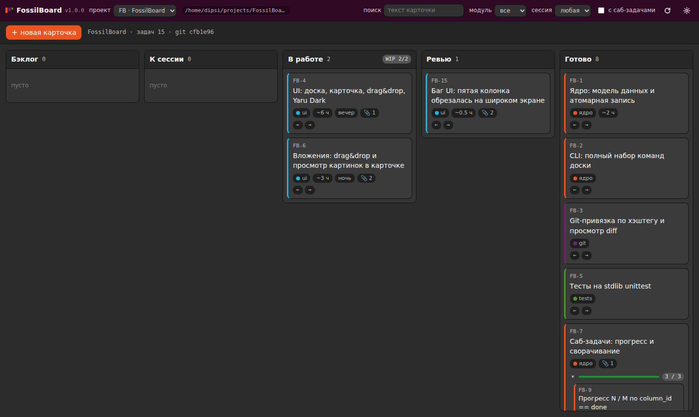
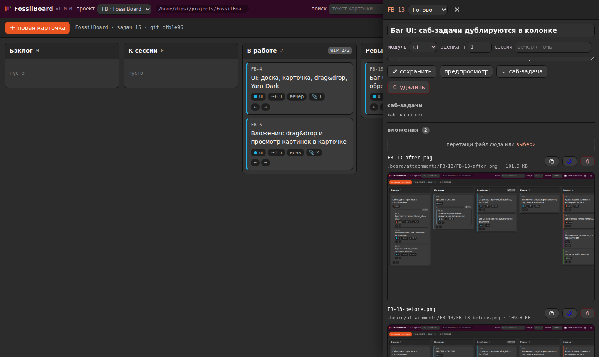

<div align="center">

# FossilBoard

**Локальная kanban-доска для одного человека и его проектов.**
Без облака, без Docker, без единой зависимости — только stdlib Python и голые HTML/CSS/JS.

[](LICENSE)
[](https://docs.python.org/3.14/)
[](#зачем-так)
[](#тесты)
[](#оформление)

</div>



---

## Что это

Доска, которая живёт **внутри git-репозитория твоего проекта**. Карточки — это файл
`.board/board.json`, версии — коммиты git. Никакой базы данных: `git diff` показывает,
что ты делал с задачами, `git log` — когда, а `git checkout` откатывает доску целиком.

Она же умеет показывать **связь задачи с кодом**: коммит с `#FB-12` в сообщении
появляется прямо в карточке, вместе с патчем.

<div align="center"></div>

## Быстрый старт

```bash
git clone git@github.com:webusis/FossilBoard.git
cd FossilBoard

./board.py init --id FB --name "FossilBoard" --repo "$PWD"   # доска для этой репы
./board.py module add "ядро" --color '#E95420'              # модуль (саб-проект)
./board.py add "Написать разбор сохранений" -m ядро -e 2     # карточка
./board.py serve --port 8770                                # ← открыть браузер
```

Дальше — <http://127.0.0.1:8770>. Сервер слушает `0.0.0.0`, так что с телефона в той
же сети доска открывается по адресу `http://<ip-компьютера>:8770`.

## Другие проекты

Рядом с селектором проекта две кнопки:

- **`+`** — новая репа: впишите путь руками, доска создаст папку, сделает `git init`
  и положит `.board/board.json`. Префикс и имя карточек можно задать там же,
  а можно оставить пустым — тогда префикс возьмётся из имени каталога;
- **📂** — открыть существующую репу: путь руками, доска только зарегистрирует
  его в конфиге и ничего не тронет. Если доски в репе нет, введите префикс и имя —
  кнопка сама переименуется в «создать доску» и создаст её прямо там.

Пока печатаете путь, снизу показывается содержимое того каталога, который вы
набираете (если его нет — его родителя), служебные папки вроде `__pycache__`
и `node_modules` не мешают, а у каждой репы есть метки `git` и `доска`. Первой
строкой идёт **«↰ вверх»** с родительским каталогом — подняться выше можно
одним кликом.

Правила кликов: по каталогу **заменяется** последний набранный сегмент
(`/home/dipsi/projects` + клик по `rezka-miner` → `/home/dipsi/rezka-miner`),
а при пустом поле подставляется абсолютный путь целиком. Под полем — что с этим
путём: «папки нет — будет создана», «не git-репозиторий», «доски нет».
`Ctrl/Cmd+O` открывает диалог сразу.

Ограничения намеренные: путь должен быть абсолютным (`~` разворачивается),
существующие файлы никогда не удаляются, из ввода не выполняется ни одна
команда — только `git init` для новой папки. Репа без `.board/board.json`
открывается с подсказкой, какую команду выполнить.

Запуск требует только Python 3.14. Ничего ставить не нужно — **и это не баг, а
фича**: `git clone`, `python3 board.py serve`, и всё.

## Зачем так

Обычная доска — это сервис, аккаунт, подписка и облачная копия твоих задач.
Для соло-проекта это лишнее. FossilBoard сознательно:

- **не имеет зависимостей** — ни pip, ни npm, ни Docker, ни CDN (даже шрифты системные);
- **не имеет базы данных** — JSON-файл в git вместо SQLite: история бесплатно, откат бесплатно;
- **не требует интернета** — всё работает офлайн, включая UI;
- **не спрашивает про аккаунты** — один пользователь, значит и прав не нужно.

## Возможности

| | |
|---|---|
| 📋 **Колонки** | Бэклог → К сессии → В работе → Ревью → Готово, перетаскивание мышью и кнопками ←/→ |
| 🎯 **WIP-лимиты** | Колонка подсвечивается, если лимит превышен |
| 🗂 **Модули** | Саб-проекты с цветом: создание, переименование, фильтр по модулю |
| 🌱 **Саб-задачи** | Вложены в родителя, прогресс `N / M`, сворачивание в `localStorage` |
| 📎 **Вложения** | Drag&drop в браузере, копирование в `.board/attachments/<id>/`, превью картинок |
| 🔗 **Git-привязка** | Коммиты по хэштегу `#FB-12` внутри карточки + кнопка **Diff** |
| 📜 **История** | События карточки и коммиты в одной ленте по датам |
| ⌨️ **CLI** | 15 команд: доска полностью управляется из терминала |
| 📝 **Markdown** | Описания с предпросмотром, всё экранируется |
| 🔗 **Ссылки** | `#FB-12` в адресе открывает карточку — можно шарить и скриншотить |
| 📂 **Новые репы** | Кнопки в шапке: создать папку с `git init` и доской или открыть существующую репу, путь вводится руками |
| 🌙 **Yaru Dark** | Тёмная тема Ubuntu Yaru, иконки — инлайновые SVG |

## CLI

Доска работает без браузера — из терминала и из агента:

```bash
./board.py add "Название" [-m ядро] [-d "описание"] [--parent FB-3] \
                    [--session вечер] [-e 2] [-c wip]
./board.py list [--module ядро] [--column wip] [--session вечер] [--parents] [-s поиск]
./board.py show FB-12 [--diff]          # карточка + привязанные коммиты
./board.py move FB-12 wip               # можно и по названию: move FB-12 "В работе"
./board.py edit FB-12 [--title ...] [--desc ...] [-m ядро] [-e 2] [--session ночь]
./board.py edit FB-12 --desc "новый текст описания"   # описание переписывается целиком
./board.py done FB-12
./board.py rm FB-12

./board.py fail FB-12 "Пробовала ставить libtk8.6 с Xft" --why "линкуется не туда" \
                    --tried "apt-get download" --tag tk   # запись, карточка остаётся на месте

./board.py sync                    # разобрать историю и дописать грабли из флагов
./board.py sync FB-12 --dry-run    # только посмотреть, что добавится
./board.py hook install            # хук post-commit: грабли подхватываются сами
./board.py hook status | remove

./board.py attach FB-12 ~/shot.png --name FB-12-after.png
./board.py detach FB-12 FB-12-after.png

./board.py module add "Ядро" --color '#88ccee'
./board.py module list
./board.py module rename "Ядро" "Движок"
./board.py module color "Движок" '#77216F'
./board.py module rm "Движок"

./board.py init --id K2C --name "Kingdom-like" --repo ~/projects/k2c-proto
./board.py projects              # список проектов
./board.py json · ./board.py serve [--port 8770]
```

### Как добавить проект

```bash
# 1. Создать доску с нуля: папка, git init, .board/board.json, регистрация
./board.py init --id K2C --name "Kingdom-like" --repo ~/projects/k2c-proto

# 2. Подключить существующую репу: доска создастся, если её ещё нет
./board.py projects add K2C "Kingdom-like" --repo ~/projects/k2c-proto

./board.py projects show K2C     # один проект в JSON
./board.py projects rm K2C       # убрать из конфига (доска в репе остаётся)
```

Восстановить карточку с прежним номером (после `rm` или при переносе из другой
доски) — `add "..." --id FB-12` или просто `--id 12`; занятый номер
отбивается, а счётчик сразу прыгает вперёд.

`init` требует, чтобы доски ещё не было, и ругается, если она есть.
`projects add` работает всегда: создаёт доску, если её нет, и просто
регистрирует путь, если есть. То же самое доступно как
`./board.py config add-project …`, если так привычнее.

Коды выхода: `0` — успех, `1` — ошибка. Никакого декоративного вывода.

## Конфигурация

Настройки лежат **в проекте**: `./board.py config init` создаёт `config.json`
рядом с `board.py`, и его можно коммитить — настройки поедут вместе с проектом.
В репозитории рядом лежит **шаблон** `config.example.json` с пояснением каждого поля.

```bash
./board.py config                    # посмотреть действующий конфиг
./board.py config where              # где доска ищет конфиг и в каком порядке
./board.py config init               # создать ./config.json из значений по умолчанию
./board.py config template           # скопировать config.example.json к себе
./board.py config set server.port 9000
./board.py config add-project FB "FossilBoard" --repo ~/projects/FossilBoard
./board.py config rm-project FB
./board.py config path               # какой файл сейчас используется
```

Доску ищет так — первое существующее и выигрывает:

| # | Где | Комментарий |
|---|---|---|
| 1 | `$FOSSILBOARD_CONFIG` | прямой путь к файлу |
| 2 | `./config.json` | рядом с доской, в репозитории — можно коммитить |
| 3 | `~/.config/fossilboard/config.json` | общесистемный, на случай нескольких досок |
| 4 | значения по умолчанию | когда файлов нет вообще |

```jsonc
{
  "server":      { "host": "0.0.0.0", "port": 8770 },
  "attachments": { "max_upload_mb": 64 },
  "git":         { "diff_max_lines": 4000 },
  "ui":          { "theme": "dark", "default_session": null },
  "paths": {
    "scratch": "/tmp/fossilboard",               // черновики и неотсортированные скрины
    "logs":    "~/.local/state/fossilboard/logs" // логи и отчёты
  },
  "projects": [
    { "id": "FB", "name": "FossilBoard", "repo_path": "/home/user/projects/FossilBoard" }
  ]
}
```

Секция `projects` — единственное, что обычно **не коммитят**: абсолютный путь к
репе — свойство машины. Всё остальное к доске природа велит держать в репозитории.

Поверх файла действуют **флаги CLI и переменные окружения**:
`FOSSILBOARD_PORT`, `FOSSILBOARD_HOST`, `FOSSILBOARD_REPO`, `FOSSILBOARD_PROJECT`.
Битый конфиг не превращается в отказ работать: доска скажет, где ошибка, и
продолжит на значениях по умолчанию.

## Git-привязка

Коммит с `#FB-12` (или `FB-12: текст`) появляется в карточке `FB-12` с хэшем,
датой, автором и кнопкой **Diff**. Связи не хранятся в `board.json` — они всегда
читаются живьём из репозитория, поэтому коммит, сделанный мимо доски, доска
тоже видит.

```bash
git commit -m "FB-12: разбор сохранений"   # → коммит появится в карточке FB-12
./board.py show FB-12                      # то же самое из терминала
```

Длинные патчи обрезаются на 4000 строк — и честно говорят об этом, вместо того
чтобы молча показать половину.

## Грабли и неудачные пути

У карточки два своих поля рядом с человеческим описанием:

```json
"gotchas":  [ { "text": "…", "flag": "rake", "source": "commit", "at": "…", "commit": "89f2b15" } ],
"attempts": [ { "text": "…", "why": "…", "tried": "…", "tags": ["tk"], "at": "…" } ]
```

Описание карточки пишут руками, автоматика пишет в поля — иначе человек и
машина правят один хвост и теряют правки. `gotchas` — уроки, которые стоит
помнить всем; `attempts` — что пробовали в моменте и почему не вышло.

Поля опциональные: старые карточки читаются как есть, `schema_version` при этом
1 → 2. Доска со схемой новее известной инструменту даёт понятную ошибку, а не
тихую потерю полей.

Видно в трёх местах: `board.py show` — блоки «грабли (N)» и «неудачные пути (N)»,
веб-карточка — отдельные секции, карточка на доске — чипы ⚠ N и ⊗ N.
Лимит — 50 записей на карточку, в вебе показываются последние 20.

## Флаги-грабли в коммитах

Коммит может нести грабли прямо в сообщении — и доска сама сложит их в карточку:

```bash
git commit -m "FB-12 #rake Тк не thread-safe: configure из фонового потока убивает окно"
./board.py sync FB-12        # → в карточке появится блок «грабли»
```

Флаги по умолчанию: `#rake` (грабля или урок), `#gotcha` (неочевидное поведение),
`#fix` (как починили), `#todo` (долг). Реестр расширяется конфигом машины, без
правки кода:

```json
"flags": { "мой-флаг": "что это значит" }
```

Правила: флаг без привязки к карточке не принимается; в одном сообщении может
быть несколько флагов (`#rake A #gotcha B`); текст грабли — всё до следующего
хэштега; повторный `sync` ничего не дублирует (ключ — пара «флаг + текст»).
Разбирается полное сообщение коммита, тело включительно.

**Грабли подхватываются сами:**

- **хук `post-commit`** — после коммита доска сама разбирает историю и дописывает
  грабли в карточки. Ставится при `init` и `projects add`, вручную —
  `board.py hook install`. Хук тихий: ошибки в лог, коммит никогда не ломается,
  чужой `post-commit` не затирается;
- **веб** — при открытии карточки доска тихо подтягивает грабли сама. Это
  страховка для коммитов, сделанных мимо хука.

Синхронизация конкретной карточки читает только её коммиты, а не всю историю
репы. Грабля достаётся первой карточке строки, где стоит флаг, а если её там
нет — первой карточке заголовка коммита.

Грабли, в строке которых упомянута карточка **чужого** проекта, не принимаются:
`TTS-15` в репе FB — это не наша карточка, такой урок в нашу карточку не
попадёт. Чужой проект известен по реестру (`projects` в конфиге машины): если
префикса в реестре нет — это обычное слово вроде `UTF-8`, а не карточка.
В другую доску доска не пишет никогда: у каждой доски своя репа.

## Как это устроено

```
FossilBoard/
├── board.py                  точка входа CLI
├── fossilboard/
│   ├── config.py             конфиг машины: пути, проекты, приоритеты настроек
│   ├── storage.py            модель данных, атомарная запись, вложения
│   ├── gitlink.py            живой поиск коммитов и diff по хэштегу
│   ├── server.py             REST поверх http.server
│   ├── cli.py                команды терминала
│   └── web/                  index.html · app.js · style.css — без сборки
├── tests/test_board.py       160 тестов на stdlib unittest
├── docs/                     скриншоты для README
└── .board/                   данные этой репы (у других проектов — у них в своих)
    ├── board.json            источник правды
    └── attachments/<FB-N>/   вложения и скриншоты
```

**Схема данных.** `schema_version`, `project`, `columns`, `modules`, `tasks`,
`counters`. Статус карточки — это её `column_id`; отдельного хранилища статусов
нет. Счётчик `counters.task` растёт монотонно, поэтому **ID удалённой карточки
никогда не переиспользуется** — `FB-12` не превратится вдруг в новую задачу.

**Атомарность.** Запись идёт через временный файл в том же каталоге и
`os.replace()`. Читатель никогда не увидит половину файла: либо старый, либо новый.
JSON пишется с отступами и сортировкой ключей — ради читаемого diff в git.

**Битый JSON не роняет инструмент.** Доска скажет, что сломалось, и даст готовую
команду восстановления из git, а не покажет белую страницу:

```bash
git -C ~/projects/k2c-proto show HEAD:.board/board.json > ~/projects/k2c-proto/.board/board.json
```

## Тесты

```bash
python3 -m unittest discover -s tests -v      # 160 тестов, ~60 с
```

Покрыты: CRUD, запрет переиспользования ID, перемещение и прогресс саб-задач,
атомарность записи, вложения, поиск коммитов по хэштегу и diff, восстановление
после битого JSON, выдача картинки по HTTP байт-в-байт, команды CLI, конфиг:
приоритеты настроек, миграция старого реестра, поведение при битом конфиге,
создание и открытие реп из UI, целостность разметки (дубли `id`, отсутствие
внешних загрузок).

## Оформление

Тёмная тема **Ubuntu Yaru** — палитра посчитана из исходников темы
(`ubuntu/yaru`, ветка `master`), а не подобрана на глаз: `--yaru-bg-color: #2C2C2C`,
акцент `#E95420`, borders `#121212`, предупреждение — mango. Иконки — свои
инлайновые SVG, чтобы не тянуть ничего извне. Подробности в [`CREDITS.md`](CREDITS.md).

## Ограничения

Что **осознанно не сделано** и почему:

- **Realtime-синхронизации нет** — вторая вкладка обновляется кнопкой ⟳. Для одного
  человека это неудобство, для команды — необходимость, а команды тут не будет.
- **SQLite/ORM нет намеренно** — JSON в git даёт историю, diff и откат бесплатно.
  На сотнях карточек переписывание файла станет узким местом; это цена за
  читаемость, и для соло-доски она окупается.
- **Привязка коммитов только по хэштегу** — никакого разбора текста описаний.
- **Отчётов, графиков, Gantt, аналитики нет** — это доска, а не трекер задач.
- **Нет аккаунтов, ролей и прав** — пользователь один.
- **Мобильного приложения и PWA нет** — обычная веб-страница, и достаточно.

## Лицензия

MIT — см. [`LICENSE`](LICENSE).